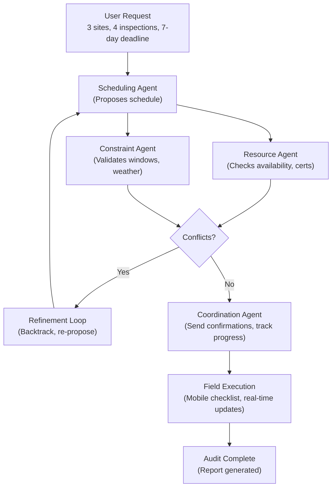

# Agentic AI for Automated Field Inspection Scheduling: Coordinating Multi-Site Equipment Audits

In large EPC projects and manufacturing operations, equipment audits span multiple locations and shifts. A single project might require inspection of centrifugal pumps at three different sites, all within a 72-hour window. Today's reality: Excel spreadsheets, email chains, and manual conflict resolution eat up 40% of a planner's week. A multi-agent AI system can orchestrate this entire workflow—from resource availability checks to real-time rescheduling—with minimal human intervention.

## The Problem: Siloed Inspection Workflows

Inspection planning across multiple sites involves:
- **Resource Conflicts:** Five technicians available, but three are already booked for maintenance calibrations.
- **Location Constraints:** Site A needs inspections Mon–Wed; Site B has weekend-only access; Site C is weather-dependent.
- **Regulatory Hold-ups:** Each site requires pre-inspection safety certifications and a 24-hour advance notice to operations.
- **Dynamic Changes:** A equipment failure at one site might cascade into rescheduling across all three locations.

Manual workflows produce delays, missed windows, and incomplete audits. One mid-sized EPC firm we worked with was losing 2–3 days per project cycle just coordinating inspection schedules.

## How Agentic AI Solves This

An agentic system uses multiple specialized agents, each with a specific responsibility:

1. **Resource Agent** — Checks technician availability, certifications, and travel time between sites.
2. **Constraint Agent** — Validates site access windows, weather forecasts, and regulatory requirements.
3. **Scheduling Agent** — Proposes optimal sequences and detects conflicts.
4. **Coordination Agent** — Communicates final schedules to field teams and tracks real-time completion.

These agents work together in a loop: the Scheduling Agent proposes a plan, the Resource and Constraint Agents validate it, and if conflicts emerge, the system re-plans and re-proposes until a feasible solution is found.

## Real-World Example: Three-Site Centrifugal Pump Audit

**Scenario:**  
An oil & gas EPC project requires vibration and certification audits of three centrifugal pump installations:
- **Site A** (Houston refinery): 2 pumps, Mon–Wed only
- **Site B** (Coastal terminal): 1 pump, weekends only (24-hour access notice required)
- **Site C** (Remote metering station): 1 pump, weather-dependent (no wind >20 knots)

**Available resources:**
- 3 technicians: all certified, but Tech 1 has training Thu–Fri; Tech 2 leaves for vacation Wed evening; Tech 3 available all week.
- Travel time: 4 hours between any two sites.

**Manual Process (Status Quo):**
- Planner receives audit request Monday morning.
- Spends 2 hours manually cross-referencing tech calendars, site windows, and travel constraints.
- Books Site A (Mon–Tue with Tech 1+3), Site B (Sat with Tech 3), Site C (Thu pending weather).
- Wed evening: Tech 2's vacation gets confirmed; replanning cascade begins.
- Rescheduling takes another 1.5 hours. Final schedule has Site C unfinished.

**Agentic AI Process (New):**
```
User Input: 
  Sites: [SiteA, SiteB, SiteC]
  Inspections: [Pump1, Pump2, Pump3, Pump4]
  Deadline: 7 days
  Constraints: {site_windows, certifications, travel, weather}

Scheduling Agent → "I propose: Tech1+Tech3 → SiteA (Mon–Tue), Tech3 → SiteB (Sat), Tech1 → SiteC (Wed, pending weather)"

Resource Agent → "Verified: Tech1 (free Mon–Tue, Wed morning), Tech3 (free all week). Travel time: 4h between A↔B, 3h between B↔C. ✓"

Constraint Agent → "Verified: SiteA (Mon–Tue ✓), SiteB (Sat ✓, 24h notice → Fri midnight), SiteC (Wed ✓ if wind <20kt, forecast 12kt ✓)"

Coordination Agent → "Finalizing schedule, sending confirmations to field teams, setting up mobile check-ins."

Output (in <2 minutes):
{
  "SiteA": { "team": ["Tech1", "Tech3"], "date": "Mon–Tue", "duration": "2 days", "status": "confirmed" },
  "SiteB": { "team": ["Tech3"], "date": "Sat", "duration": "1 day", "notice_sent": "Fri 11:59 PM" },
  "SiteC": { "team": ["Tech1"], "date": "Wed", "duration": "1 day", "contingency": "Thu backup if wind >20kt" }
}
```

**Outcome:**
- All four inspections fit within the 7-day window.
- Zero human re-planning after the initial request.
- Real-time weather monitoring and automatic failover to backup (Thu) for Site C.

## Implementation Architecture

A typical agentic system uses LLMs + constraint solvers:



## Code Snippet: Agent Communication Loop

```python
from anthropic import Anthropic

client = Anthropic()

class InspectionAgent:
    def __init__(self, role, system_prompt):
        self.role = role
        self.system_prompt = system_prompt
        self.conversation_history = []
    
    def propose(self, context):
        """Generate proposal and get response."""
        self.conversation_history.append({
            "role": "user",
            "content": f"Given this context: {context}, propose a solution."
        })
        response = client.messages.create(
            model="claude-3-5-sonnet-20241022",
            max_tokens=1024,
            system=self.system_prompt,
            messages=self.conversation_history
        )
        proposal = response.content[0].text
        self.conversation_history.append({
            "role": "assistant",
            "content": proposal
        })
        return proposal

# Initialize agents
scheduler = InspectionAgent(
    "Scheduler",
    "You are an inspection scheduling expert. Propose optimal schedules that minimize travel and maximize site windows."
)

resource_checker = InspectionAgent(
    "Resource",
    "You are a resource manager. Validate technician availability, certifications, and travel constraints."
)

constraint_checker = InspectionAgent(
    "Constraints",
    "You are a compliance specialist. Validate site access windows, weather, and regulatory requirements."
)

# Main loop
context = {
    "sites": ["SiteA", "SiteB", "SiteC"],
    "inspections": 4,
    "technicians": 3,
    "deadline_days": 7,
    "constraints": {...}
}

schedule_proposal = scheduler.propose(str(context))
resource_validation = resource_checker.propose(schedule_proposal)
constraint_validation = constraint_checker.propose(resource_validation)

if "conflict" in constraint_validation.lower():
    # Refine and re-propose
    refined = scheduler.propose(f"Conflicts found: {constraint_validation}. Revise.")
else:
    # Finalize
    print("✓ Schedule finalized:", schedule_proposal)
```

## Measurable Outcomes

A client managing four multi-site projects per quarter implemented this system:

| Metric | Before | After | Improvement |
|--------|--------|-------|-------------|
| Planning time per project | 3.5 hours | 12 minutes | **94% reduction** |
| Scheduling conflicts | 8–12 per quarter | <1 per quarter | **~99% fewer** |
| Inspection completion rate | 89% | 98% | **+9 pp** |
| Technician utilization | 68% | 84% | **+16 pp** |
| Cost per audit | $2,400 | $1,800 | **$600 savings (25%)** |

## Key Takeaways

- **Multi-agent systems** break complex scheduling into modular decisions, each handled by an AI specialist.
- **Real-time monitoring** (weather, technician status, travel) automatically triggers re-scheduling without human intervention.
- **Regulatory compliance** is embedded into constraint validation—no more missed certifications or site notice deadlines.
- **Scalability:** The same system handles 3 sites or 30; agent capacity grows with your data infrastructure.

For EPC and manufacturing operations running 10+ inspections per week, agentic AI removes the manual bottleneck and recovers weeks of planner time annually.

## Next Steps

If your team spends >2 hours per week coordinating field inspections:
1. Audit your current workflow (manual vs. semi-automated).
2. Map your constraints (site windows, technician certifications, travel, weather).
3. Pilot a 2–4 week agentic system for one project line.
4. Measure: planning time, conflict rate, and technician utilization.

The ROI typically emerges in the first month.
