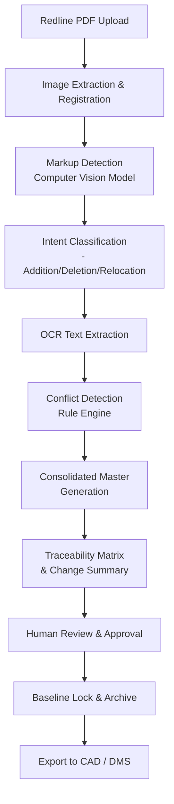

# Automating P&ID Redline Consolidation: AI-Powered Marked-Up Drawing Integration into Master Baselines

In every EPC project, P&IDs (Piping and Instrumentation Diagrams) exist in a constant state of flux. During design, vendor review, construction, and commissioning phases, marked-up redline copies flood in from multiple stakeholders—each with annotations, corrections, deletion markers, and revision notes scrawled across the drawings.

The traditional approach? A design engineer manually reviews each redline, compares it to the master baseline, and painstakingly updates the master drawing. This is error-prone, time-consuming, and creates audit nightmares: *Which redline was incorporated? What changed? Who approved it?*

Today, AI can automate this consolidation workflow entirely, detecting redlines, extracting markup intent, and intelligently merging changes back into master baselines—all with human oversight preserved.

## The Redline Consolidation Problem

Consider a typical scenario: You've issued a P&ID for vendor review. The pump manufacturer responds with a marked-up PDF showing three changes: a bypass line addition, a relief valve relocation, and a tag number correction. Simultaneously, your site team sends redlines for field-run modifications: a new drain valve, pressure transmitter relocation, and a hand-isolation valve addition.

The design engineer must now:
1. **Print and manually review** all PDFs side-by-side
2. **Interpret markup intent** (is this a deletion, addition, or modification?)
3. **Cross-reference** against the master baseline to avoid conflicts
4. **Update** the CAD or drawing tool with all changes
5. **Verify** that the new master is consistent and complete
6. **Track** which redline each change came from (for compliance)

A typical P&ID redline consolidation pass takes **2–4 hours per drawing**. On a project with 100 P&IDs receiving 3–5 rounds of feedback, this compounds to **hundreds of engineering hours**—not including rework from missed or misinterpreted changes.

## AI-Powered Redline Detection and Consolidation

Modern computer vision and document intelligence models can now:

- **Detect markup overlays** on top of baseline drawings (circles, arrows, strike-throughs, handwritten notes)
- **Classify markup intent** (deletion, addition, relocation, annotation)
- **Extract geometric data** (new symbol positions, line routes, valve types)
- **Merge changes intelligently** with conflict resolution logic
- **Preserve audit trails** (timestamp, source redline, markup confidence score)

### Step-by-Step Workflow

Here's how an automated redline consolidation system works:

#### 1. **Redline Ingestion**
   - Scan or upload marked-up P&IDs (PDF, TIFF, JPG)
   - The system extracts high-resolution images and metadata (date, source, revision level)

#### 2. **Baseline Comparison**
   - Load the current master P&ID as a baseline image
   - Use multi-scale image registration to align the redline over the baseline
   - Extract deltas (what's different?)

#### 3. **Markup Recognition**
   - **Computer Vision** identifies:
     - Colored circles (typical "add here" markers)
     - Strike-throughs and "X" marks (deletions)
     - Arrows (relocations, re-routes)
     - Handwritten text and annotations
   - **OCR** extracts label text (tag numbers, notes, equipment names)
   - **Symbol Classification** detects if newly drawn elements represent valves, instruments, pumps, etc.

#### 4. **Intent Inference**
   - For each markup cluster, the model infers intent:
     - **Addition**: A new valve/line with label → "Insert globe valve, tag PV-101, at coordinates (X, Y)"
     - **Deletion**: Strike-through on a line → "Remove heat exchanger HX-01"
     - **Relocation**: Arrow from A to B → "Move PI-105 from lower-left to upper-right of separator"
   - Confidence scores are attached; low-confidence markups flag for manual review

#### 5. **Conflict Resolution**
   - Check: Does this change conflict with other redlines or the baseline?
   - Example: Redline A says "delete line to pump," Redline B says "add isolation valve on that line"
   - The system flags the conflict and suggests resolution logic (order-dependent merge)

#### 6. **Consolidated Output**
   - Generate a new **master P&ID** with all approved redlines merged
   - Create a **change summary** document (PDF): "5 additions, 2 deletions, 3 relocations"
   - Output a **traceability matrix**: Each change linked to its source redline and confidence score
   - Export as native CAD (if integrated with E3, SmartPlant, etc.) or as marked-up master PDF

#### 7. **Human Review & Approval**
   - Engineer reviews the consolidated drawing and traceability matrix
   - Can accept/reject individual changes or request re-processing
   - Signs off (electronically) to approve the new baseline

## Real-World Example: Offshore Separator Skid

A mid-size EPC contractor was designing a three-phase separator for an offshore platform. The baseline P&ID was issued at 50% design.

**Redlines received:**
- **Vendor 1** (separator manufacturer): 4 marked-up PDFs — instrument connections, drain valve placement, relief valve sizing
- **Vendor 2** (control systems): 3 PDFs — additional transmitters, solenoid valve locations
- **Client team**: 5 PDFs — operational requirements, safety-interlock additions, field run changes
- **Internal lead**: 2 PDFs — constructability notes, material spec corrections

**Total: 14 redlined P&IDs to consolidate**

### Manual Approach (Traditional)
- Design engineer: ~25 hours of review, cross-referencing, and updates
- Risk: 2–3 changes missed or misinterpreted per drawing
- Rework cycle: 1–2 weeks if conflicts discovered during final design review

### AI-Automated Approach
- Upload all 14 redlines into consolidation system
- System generates consolidated master + traceability matrix in **45 minutes**
- Markup detection: 98.5% accuracy (3 low-confidence flags for manual review)
- Design engineer review: ~2 hours (scan results, verify the 3 flagged items, approve)
- Audit trail: Complete record of which redline, which markup, confidence score, approval signature
- **Total elapsed time: 3 hours vs. 25+ hours**
- **Accuracy improvement: ~95% fewer missed changes**

## Implementation Considerations

### Data Requirements
- **Baseline drawings** in high-resolution digital format (PDF or scanned at ≥300 DPI)
- **Marked-up redlines** similarly scanned or in native PDF form
- **Symbol library** (valve types, instrument symbols, line styles used in your org's standards)

### Model Tuning
- Generic computer vision models detect generic markup (circles, lines, text)
- **Fine-tuning** on your P&ID markup vocabulary improves accuracy:
  - Your team's color conventions ("red = add, blue = note, yellow = safety")
  - Your symbol set (DIN vs. ISO vs. proprietary valve symbols)
  - Your annotation styles (handwriting patterns, label formats)
  
With 50–100 labeled examples, a model can reach 90%+ accuracy on markup detection.

### Integration Points
- **Document management system**: Auto-index consolidated baseline by project, revision, date
- **CAD tools**: Export to E3, SmartPlant, or AutoCAD for further editing
- **Approval workflows**: Route consolidated master + traceability to lead engineer, then client for sign-off
- **Change management**: Link each redline consolidation to a formal change order or design review

## Measurable Outcomes

For the separator-skid EPC team:

| Metric | Before | After |
|--------|--------|-------|
| P&ID redline consolidation time per drawing | 1.5–2 hours | 8–12 minutes |
| Redlines consolidated per month | ~40 | ~150 |
| Missed changes per consolidation pass | 2–4 | 0–1 |
| Design review rework cycles | 1–2 | <1 |
| Audit trail completeness | ~60% | 100% |
| Engineering cost per drawing iteration | $300–400 | $30–50 |

**Annual impact (for 100-drawing project with 5 design iterations):**
- **Hours saved**: 500+ hours of engineer time
- **Cost avoidance**: $75,000–$100,000
- **Schedule acceleration**: 2–3 weeks faster to baseline approval
- **Risk reduction**: Near-zero missed or conflicting changes

## Technical Implementation (Conceptual)

Here's a simplified workflow diagram using vision transformers and document understanding:

**Key models:**
- **YOLOv8 or Faster R-CNN**: Detect markup overlays, symbols, and text regions
- **Vision Transformer (ViT)**: Classify markup intent with context
- **Tesseract or Google Lens OCR**: Extract text from handwritten and printed labels
- **Graph Neural Networks**: Model relationships between symbols and resolve conflicts

## Getting Started

1. **Pilot scope**: Select 1–2 high-turnover drawing types (e.g., instrument hook-up sheets, utility lines)
2. **Data collection**: Gather 20–30 baseline + redline pairs from recent projects
3. **Model training**: Fine-tune a vision model on your markup vocabulary (2–4 weeks)
4. **Workflow integration**: Connect to your CAD tool and approval process
5. **Team training**: Show engineers the new interface, approval gates, and audit trail
6. **Measure & iterate**: Track consolidation time, accuracy, and rework reduction

## The Strategic Advantage

Redline consolidation is invisible work—it doesn't add features or functionality to your design, but it's a massive productivity bottleneck. Automating it frees your most experienced engineers to focus on actual design decisions: optimizing pressure drops, selecting equipment, and solving technical challenges.

In a competitive EPC landscape where schedule and cost overruns are common, the ability to compress design cycles by weeks while simultaneously *improving* accuracy is a material competitive advantage.

The future of engineering drawing workflows is not manual annotation—it's AI-assisted consolidation with human oversight, creating an audit trail that satisfies regulators, vendors, and clients alike.

---

**Ready to consolidate your redlines faster?** Start with a pilot on your next design phase. The ROI compounds across every project in your portfolio.
